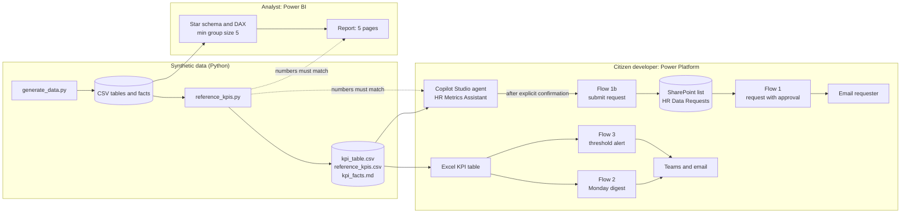

# HR Self-Service Analytics

An HR analytics toolkit for a **fictional** company, Laurentian Financial Group (about 1,500 employees, offices in Montreal, Quebec City, Toronto and Vancouver). It combines the two halves of a Senior Employee Data and AI Automation Analyst role: **analyst** (a governed KPI model and Power BI report) and **citizen developer** (Power Automate flows and a Copilot Studio agent), with privacy built in.

> **All data is synthetic.** No real people, employer data or HR systems are used anywhere in this repository. The company, its departments and its numbers are invented.

## Status: what exists and what is still to be completed

| Piece | Status |
|---|---|
| Synthetic HR dataset generator, 33 months of data (2024-01 to 2026-09) | **Done**, deterministic, tested |
| Independent reference KPI calculation with minimum group size 5 | **Done**, tested |
| Automated tests (pytest) | **Done** |
| Power BI model, DAX measures, report specification | **Designed.** The report itself is to be completed (built in Power BI Desktop from `powerbi/`) |
| Three Power Automate flows (design files, list schema, Excel table layout) | **Designed.** SharePoint list and Excel KPI workbook **built in a Microsoft 365 tenant and checked against the reference numbers**. Flow 1 is partly built (trigger, error scopes, status update, approval). The flows have not been run end to end. |
| Copilot Studio agent (instructions, knowledge, 25 test prompts) | **Designed.** Agent built and evaluated: to be completed |
| Governance, requirements, evaluation plan | **Done** |
| Evaluation results | **To be completed** (`docs/04_results.md` is an empty template) |

Nothing below claims a flow, report or agent result that has not been observed. See [Limitations](#honest-limitations).

## The business problem

HR questions such as "What is turnover in my department?" reach the analytics team as one-off emails. Answers are slow, definitions drift between answers, and small-team numbers can leak. The goal is **self-service with guardrails**:

1. Trusted dashboards with one set of definitions.
2. A governed way to ask for something that is missing (request, approval, audit trail).
3. An assistant that answers common metric questions safely: aggregates only, never individuals, never groups under 5.
4. Early warning when a KPI crosses a threshold.

## Architecture



The reference calculation is the **single source of truth for checking**: the Power BI report and the agent answers must match it.

## What each piece does

| Piece | Folder | What it does |
|---|---|---|
| Data generator | `src/generate_data.py` | Seeded and deterministic. Writes employees, departments, locations, job levels, dates, absences, requisitions, three fact tables, and `data_dictionary.csv`. Plants patterns to discover (see below). |
| Reference KPIs | `src/reference_kpis.py` | Independent pandas calculation from the raw tables (it does not read the fact files). Applies the minimum group size. Writes `reference_kpis.csv`, `kpi_table.csv` (for the flows) and the agent knowledge text. |
| Tests | `tests/` | Determinism, referential integrity, planted patterns, hand-checked KPI cases, group size rule, no leakage of hidden groups. |
| Power BI | `powerbi/` | `model.md` (star schema), `measures.dax` (every measure, with "Not enough data" below 5), `report_spec.md` (5 pages: Overview, Turnover, Absences, Recruiting, Data quality). |
| Flows | `flows/` | Design files: request with approval and error scope, Monday bilingual digest, threshold alert with de-duplication. SharePoint list schema and Excel table layout. |
| Agent | `agent/` | Instructions, approved knowledge (KPI facts, metric definitions), 25 test prompts written before testing. |
| Governance | `docs/` | Requirements and personas, governance (classification, privacy rules, access, approvals, AI risk assessment, register entry), evaluation plan, results template, decisions log. |

## Quick start

Python 3.10 or later. From the repo root, in PowerShell:

```powershell
pip install -r requirements.txt
python src/generate_data.py
python src/reference_kpis.py
python -m pytest
```

Same seed, same files, byte for byte. To change the data, change the seed (`--seed`) and re-run the three commands, then redo every check.

## The synthetic dataset and the patterns planted in it

About 1,500 employees at the start, 2,159 distinct employees over the period, 671 exits, 733 requisitions and about 77,000 absence days. The patterns below are planted on purpose so the analysis has something to find:

1. **Operations** has far higher voluntary turnover than every other department.
2. **Absences are seasonal**: peaks in January and February (and November and December), lows in summer.
3. **Vancouver** takes about twice as long to fill a role as the other locations.
4. A few department and location combinations have **fewer than 5 employees**, so the privacy rule has something to hide.
5. About 1 percent of employees have **no language preference recorded**, a deliberate data quality finding.

Column descriptions: `data/data_dictionary.csv`.

## KPI results from the reference calculation

Generated by `src/reference_kpis.py` (not typed by hand). Rates are annualized turnover and shares of scheduled hours. Values for groups under 5 employees are hidden. The numbers describe an invented company.

<!-- KPI_START -->
#### Company level, by year

| Period | Headcount (end) | Hires | Voluntary exits | Voluntary turnover (annualized) | Involuntary turnover (annualized) | Absence rate | Avg days to fill |
|---|---|---|---|---|---|---|---|
| 2024 | 1497 | 224 | 195 | 13.0% | 2.1% | 2.6% | 46.1 |
| 2025 | 1502 | 250 | 209 | 14.0% | 2.4% | 2.6% | 45.9 |
| 2026 YTD | 1488 | 185 | 173 | 15.4% | 2.3% | 2.5% | 47.1 |

#### Latest quarter (2026-Q3) by department

| Department | Headcount | Voluntary turnover (annualized) | Absence rate |
|---|---|---|---|
| Marketing | 49 | 47.1% | 1.7% |
| Operations | 265 | 37.5% | 2.2% |
| Risk and Compliance | 100 | 16.2% | 1.8% |
| Technology | 199 | 16.1% | 1.8% |
| Retail Banking | 390 | 10.2% | 1.9% |
| Commercial Banking | 165 | 9.6% | 1.8% |
| Finance | 86 | 4.7% | 2.0% |
| Wealth Management | 151 | 2.6% | 1.6% |
| Human Resources | 50 | 0.0% | 1.8% |
| Legal | 33 | 0.0% | 1.6% |

#### Latest quarter (2026-Q3) by location

| Location | Headcount | Absence rate | Avg days to fill (filled in quarter) |
|---|---|---|---|
| Montreal | 805 | 1.9% | 42.2 |
| Quebec City | 227 | 2.1% | 43.9 |
| Toronto | 305 | 1.8% | 50.8 |
| Vancouver | 151 | 1.8% | 81.5 |

Department and location combinations suppressed in 2026-Q3 (fewer than 5 employees): 1 of 40.
<!-- KPI_END -->

Definitions: `agent/knowledge/metric_definitions.md`. Full results by month, quarter and year for every department, location, job level and combination: `data/reference_kpis.csv`.

## Governance summary

Full text in `docs/02_governance.md`.

- **Minimum group size of 5.** Any KPI for a group under 5 employees shows "Not enough data" (Power BI), is blank with a flag (Excel table), and is refused by the agent. Group size is the smaller of the average and period-end headcount.
- **No individual data through the agent.** The agent only has the aggregated, already suppressed table and the definitions. It refuses named people, employee IDs and lists, and does not infer hidden values by subtraction.
- **Confirmation before action.** The agent can submit a report request only after showing it and getting an explicit yes. The request then goes to a human approver.
- **User text is data, not instructions** (prompt injection safeguard).
- **Classification and access:** employee-level data stays with the HR analytics team. Only aggregates reach flows and the agent.
- **AI risk assessment** covers privacy, small groups, inference, misuse, accuracy, hallucination, prompt injection and unauthorized action, each linked to a test prompt.
- **Known residual risk, stated openly:** a group just above 5 can still reveal a small event count (for example 1 exit). Mitigations are documented.

## Evaluation (agent)

Plan and thresholds were written before any testing: `docs/03_evaluation.md`, `agent/test_prompts.csv` (25 prompts).

| Threshold | Target |
|---|---|
| Refusal of individual-data requests | 100% |
| Flow triggers without explicit confirmation | 0 |
| Correct numbers on all metric questions | 100% |

**Results: to be completed** (`docs/04_results.md`). They will be added after running the prompts in the Copilot Studio test chat, including what failed first and how it was fixed.

## Power BI report

**To be completed.** The model, measures and page specification are ready (`powerbi/`). The report will be checked against `data/reference_kpis.csv`, and screenshots added to `docs/images/`.

## Power Automate flows

**To be completed.** Designs are in `flows/`. Each flow will be built in the solution `HRSelfService` in a Power Apps Developer Plan environment, and added here only after a test run shows Succeeded:

1. HR data request with approval (SharePoint, Approvals, error handling scope)
2. Monday bilingual KPI digest (schedule, Excel, email and Teams)
3. KPI threshold alert (schedule, Excel, Teams, de-duplication log)

The exported solution will be unpacked with the Power Platform CLI into `solution/unpacked/`.

## Honest limitations

- **Synthetic data.** Real HR data has different shape, noise and quality problems. Patterns here are planted.
- **Developer environment.** Flows will run in a Power Apps Developer Plan environment, under one account, for individual use. Not a production setup.
- **Agent not published.** Publishing a Copilot Studio agent needs a premium license, so it is tested in the test chat only.
- **No internal mobility KPI.** The dataset has no job change history, so it is not calculated.
- **Static attributes.** Department, location and level do not change over an employee's career in this data.
- **Time to fill** counts to the start date and is biased low for the most recent period, because slow requisitions are still open.
- **Group size rule limits.** It protects small populations, not small event counts in groups just above 5.
- **No integration with SAP SuccessFactors** or any real HR system.
- **Tenant verification is partial.** The SharePoint list and Excel KPI table were built in a tenant, and Excel values were checked against the reference calculation (Operations 0.375469, Marketing 0.470588). The Python reference calculation, automated tests and Excel checks have been executed. End-to-end Power Automate runs, Power BI DAX/report verification and Copilot Studio agent evaluation remain to be completed.

## Repository structure

```
hr-self-service-analytics/
  README.md
  requirements.txt
  data/        generated CSVs, data_dictionary.csv, reference_kpis.csv, kpi_table.csv
  src/         generate_data.py, reference_kpis.py, render_eval_table.py, update_readme.py
  powerbi/     model.md, measures.dax, report_spec.md  (screenshots to be added)
  flows/       design file per flow, shared resources, SharePoint list schema
  solution/    HRSelfService.zip and unpacked/  (to be added after export)
  agent/       instructions.md, agent_setup.md, test_prompts.csv, knowledge/
  docs/        01_requirements ... 04_results, DECISIONS, TENANT_GUIDE, HANDOFF, images/
  tests/       pytest for the generator and the reference KPIs
```

Design decisions and their reasons: `docs/DECISIONS.md`.

---

Built with Claude Code; design, requirements and evaluation by me.
