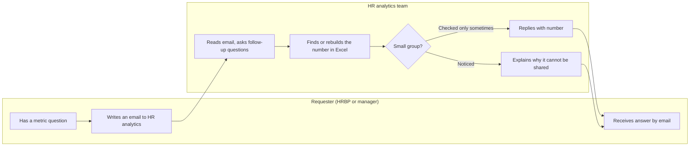
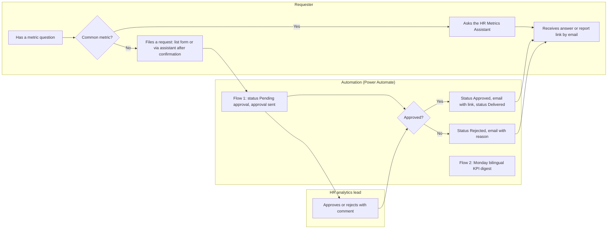

# 05. Discovery and process analysis

Fictional client: Laurentian Financial Group (about 1,500 employees). All data is synthetic. This document shows how the engagement would run discovery and turn it into a recommendation. Interview findings below are written as a realistic scenario, not as real interviews.

## 1. Discovery approach

| Activity | Who | Output |
|---|---|---|
| Sponsor interview (45 min) | Senior Director, Analytics | Goals, success measures, constraints, decision rights |
| Process owner workshop (90 min) | HR analytics lead, one HR analytics developer | Current state process map, request volumes, definitions in use |
| User interviews (30 min each, 5 to 6) | HR business partners, two managers | Pain points, questions they ask most, how they use the answers |
| Privacy and security check-in (30 min) | Privacy officer, M365 admin | Data classification, minimum group size, licensing, tenant rules |
| Artifact review | Existing reports, request emails, KPI spreadsheet | Definition drift, duplicate reports, volume estimate |

## 2. Stakeholder map

| Stakeholder | Role in the change | Interest | Influence | Engagement approach |
|---|---|---|---|---|
| Senior Director, Analytics | Sponsor, approves scope and budget | High | High | Monthly steering, executive briefing (`09_executive_briefing.md`) |
| HR analytics lead (Sophie) | Process owner, approver of requests, owns KPI definitions | High | High | Co-designs the process, signs off UAT |
| HR business partners (Isabelle) | Main requesters and primary users | High | Medium | Champions, pilot group, office hours |
| Managers (Marc) | Consumers of digest and assistant | Medium | Medium | Short demos, job aid, digest email |
| Privacy officer | Approves group size rule and agent publishing | Medium | High | Governance review, risk assessment sign-off |
| M365 / Power Platform admin | Environment, DLP policies, licensing | Low | High | Early technical handoff, solution export |

## 3. Current state

### Pain points and root causes

| Pain point | Root cause | Impact |
|---|---|---|
| Answers take days | Every question is a manual, one-off request with no intake form | Decisions made without data, or with old data |
| Same metric, different numbers | No single published definition; each analyst calculates it their own way | Loss of trust in HR numbers |
| Small-team numbers leak | Group size check depends on the analyst remembering it | Privacy risk, Law 25 exposure |
| No visibility of request status | Requests live in personal inboxes | Follow-up emails, duplicated work |
| No audit trail of who asked for what and why | No structured record or approval | Cannot show purpose limitation to privacy office |

## 4. Future state

What changes for each role:

| Role | Before | After |
|---|---|---|
| HR business partner | Emails and waits | Asks the assistant for common metrics; files structured requests for the rest and sees status in the list |
| Manager | Asks the HRBP | Reads the Monday digest; asks the assistant |
| HR analytics lead | Triages an inbox | Approves structured requests with purpose recorded; one place for definitions |
| Privacy officer | Trusts manual checks | Group size rule enforced in data, flows and agent; tested with written prompts |

## 5. Requirements traceability

Full user stories and acceptance criteria are in `01_requirements.md`. The table below links each pain point to the requirement, the build component and the test that proves it.

| Pain point | Requirement | Component | Test |
|---|---|---|---|
| Slow answers | US-10 metric questions | Copilot Studio agent | T01 to T07 |
| Definition drift | US-10, US-13 | Agent knowledge `metric_definitions.md` | T08, T09 |
| Small-team leaks | US-06, US-11 | Suppressed KPI table, agent rules | T10 to T12 |
| No status or audit trail | US-07 | Flow 1, SharePoint list | UAT-01 to UAT-04 |
| No proactive view | US-08 | Flow 2 digest | UAT-06 |

## 6. Options assessed

| Option | Value | Feasibility | Risk | Readiness |
|---|---|---|---|---|
| A. Training and a shared definitions document only | Low: still manual | High | Low | High |
| B. Power BI self-service report only | Medium: helps people who open dashboards | High | Low | Medium: managers rarely open reports |
| C. **Governed request flow + weekly digest + metric assistant (recommended)** | High: covers ad hoc, routine and proactive needs | Medium: Power Platform skills needed, licensing to confirm | Medium: AI answers need controls and evaluation | Medium: needs champions and a pilot |
| D. M365 Copilot over HR files, no custom agent | Medium | High if licensed | High: no control over what it reads or how small groups are handled | Low: privacy office would not approve |

## 7. Recommendation

Option C, in three phases:

1. **Phase 1 (weeks 1 to 3):** request flow with approval and audit trail, KPI table with group size rule, UAT with HR analytics. Low AI risk, fast value.
2. **Phase 2 (weeks 4 to 6):** HR Metrics Assistant in a pilot with 5 HR business partners, evaluated against the 25 written test prompts before any wider use.
3. **Phase 3 (weeks 7 to 10):** weekly digest to managers, adoption program, value measurement against the baseline in `07_value_measurement.md`.

Escalate to specialists: production tenant DLP policies, service account for connections, and any integration with the HRIS (SAP SuccessFactors), which is out of scope for this prototype.
