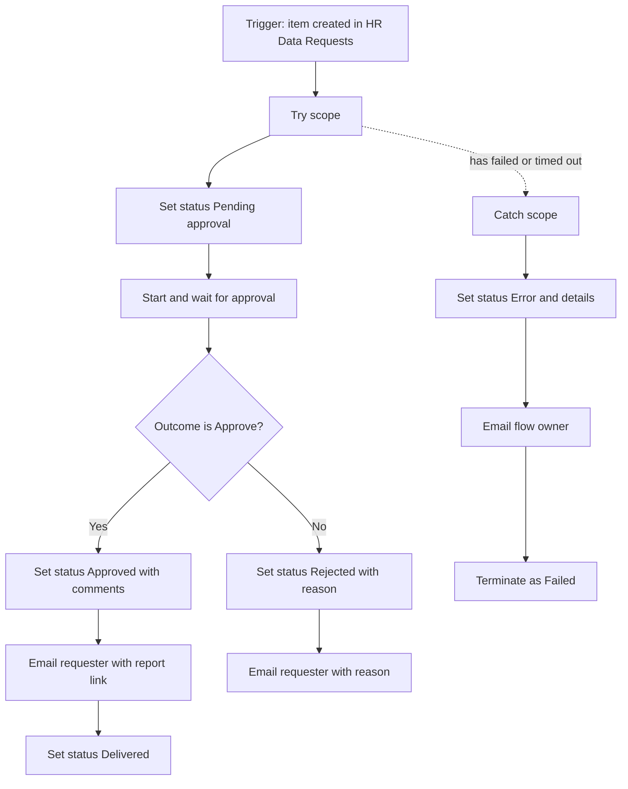

# Flow 1: HR data request with approval

**Name:** `HRSS - 1 HR data request with approval`
**Description (paste in the flow description):** When someone adds an item to the HR Data Requests list, sends an approval to the HR analytics lead. If approved, emails the requester the report link. If rejected, emails the reason. The list item Status is updated at every step. A failure sets Status to Error and notifies the flow owner. Synthetic demo for Laurentian Financial Group.
**Type:** Automated cloud flow, in solution `HRSelfService`.
**Resources:** see `00_shared_resources.md` (list schema, environment variables, connection references).
**Privacy:** no employee level data. The request contains department, report type, period and a business reason.

## Overview



## Inputs and outputs

| | |
|---|---|
| Input | A new item in `HR Data Requests` (columns in the schema). |
| Outputs | Item `Status` and approval fields updated. Email to the requester. Approval record in the Approvals app. |
| Success | Status ends as `Delivered` (approved) or `Rejected`. Flow run Succeeded. |
| Failure | Status `Error`, `ErrorDetails` filled, owner emailed, flow run Failed. |

## Trigger

| # | Action | Settings |
|---|---|---|
| 0 | **SharePoint: When an item is created** | Site address: your site. List name: `HR Data Requests`. Comment: "Starts the flow for every new request, from the form or from the agent helper flow." |

## Actions in order

Create two **Scope** actions, `Try` and `Catch`. Put the actions of the main path inside `Try`.

### Scope `Try`

| # | Action (rename to) | Connector and action | Parameters | Comment (add to the action) |
|---|---|---|---|---|
| 1 | `Set status Pending approval` | SharePoint: **Update item** | Id: `ID` from the trigger. Title: `Title` from the trigger (required field, pass it through). Status Value: `Pending approval`. Flow run link: expression below. | "Status moves to Pending approval so the requester sees progress." |
| 2 | `Compose requester email` | Data operation: **Compose** | Expression: `if(empty(triggerOutputs()?['body/RequesterEmail']), triggerOutputs()?['body/Author/Email'], triggerOutputs()?['body/RequesterEmail'])` | "Agent requests carry the real requester in RequesterEmail. Form requests use Created By." |
| 3 | `Start approval` | Approvals: **Start and wait for an approval** | Approval type: **Approve/Reject - First to respond**. Title: `HR data request: @{triggerOutputs()?['body/Title']}`. Assigned to: environment variable `hrss_HRAnalyticsLeadEmail`. Details (markdown): see below. Item link: the list item link (`triggerOutputs()?['body/{Link}']`). Item link description: `Open the request`. Requestor: output of step 2. | "Waits for the HR analytics lead. Default approval timeout is 30 days. Reduce the timeout in the action settings, Timeout, to P3D (3 days) so a forgotten request ends in Catch." |
| 4 | `Check outcome` | Control: **Condition** | `Outcome` (from step 3) is equal to `Approve` | "Branch on the approver's decision." |

Details text for step 3 (Markdown):

```
**Requester:** @{outputs('Compose_requester_email')}
**Report:** @{triggerOutputs()?['body/RequestType/Value']}
**Department:** @{triggerOutputs()?['body/Department/Value']}
**Period:** @{triggerOutputs()?['body/Period/Value']}
**Business reason:** @{triggerOutputs()?['body/BusinessReason']}

Reminder: only aggregated data with a minimum group size of 5 can be shared.
```

Flow run link expression (steps 1 and Catch):

```
concat('https://make.powerautomate.com/environments/', workflow()?['tags']?['environmentName'], '/flows/', workflow()?['name'], '/runs/', workflow()?['run']?['name'])
```

**If yes (Approve):**

| # | Action | Parameters | Comment |
|---|---|---|---|
| 5a | `Set status Approved` (SharePoint: Update item) | Id and Title as before. Status: `Approved`. ApprovalComments: `first(body('Start_approval')?['responses'])?['comments']`. DecisionBy: `first(body('Start_approval')?['responses'])?['responder']?['displayName']`. DecisionOn: `utcNow()`. | "Records who decided, when and any comment." |
| 5b | `Email requester approved` (Office 365 Outlook: **Send an email (V2)**) | To: output of step 2. Subject: `HR data request approved / Demande de données RH approuvée: @{triggerOutputs()?['body/Title']}`. Body (HTML, bilingual): see below. | "Delivers the report link. Bilingual because the audience is bilingual." |
| 5c | `Set status Delivered` (SharePoint: Update item) | Status: `Delivered`. | "Final status for the approved path." |

Approved email body:

```html
<p>Bonjour,</p>
<p>Votre demande <b>@{triggerOutputs()?['body/Title']}</b> a été approuvée. Voici le lien du rapport :
<a href="@{parameters('hrss_ReportLink (hrss_ReportLink)')}">Rapport RH libre-service</a>.</p>
<p>Rappel : les groupes de moins de 5 employés sont masqués. Données synthétiques de démonstration.</p>
<hr>
<p>Hello,</p>
<p>Your request <b>@{triggerOutputs()?['body/Title']}</b> was approved. Here is the report link:
<a href="@{parameters('hrss_ReportLink (hrss_ReportLink)')}">HR self-service report</a>.</p>
<p>Reminder: groups with fewer than 5 employees are hidden. Synthetic demo data.</p>
```

The parameter name for an environment variable in the expression editor follows the pattern `parameters('Display name (schema name)')`. Use the dynamic content picker and let Power Automate insert it instead of typing it.

**If no (Reject):**

| # | Action | Parameters | Comment |
|---|---|---|---|
| 6a | `Set status Rejected` (SharePoint: Update item) | Status: `Rejected`. ApprovalComments: the approver's comments. DecisionBy and DecisionOn as in 5a. | "Stores the rejection reason on the item." |
| 6b | `Email requester rejected` (Send an email V2) | To: output of step 2. Subject: `HR data request not approved / Demande de données RH non approuvée: @{triggerOutputs()?['body/Title']}`. Body: bilingual, includes the reason `first(body('Start_approval')?['responses'])?['comments']`. If the comment is empty, show `No reason given / Aucune raison fournie` using `coalesce(..., 'No reason given / Aucune raison fournie')`. | "Tells the requester why." |

### Scope `Catch` (error handling)

Add the scope after `Try`. Click the "..." on `Catch`, then **Configure run after**. Tick **has failed**, **is skipped** (leave unticked) and **has timed out**. Untick **is successful**. So `Catch` runs only when `Try` failed or timed out.

| # | Action | Parameters | Comment |
|---|---|---|---|
| E1 | `Compose error details` (Compose) | Inputs: `result('Try')`. This keeps the full array of action results (status, error code and message of each action). | "Captures the status and error message of every action in Try." |
| E2 | `Set status Error` (SharePoint: Update item) | Id and Title. Status: `Error`. ErrorDetails: `string(outputs('Compose_error_details'))` (truncate with `substring(string(...), 0, min(length(string(...)), 1500))` if the list rejects long text). FlowRunLink: the run link expression. | "Makes the failure visible on the item, not only in the run history." |
| E3 | `Email flow owner` (Send an email V2) | To: environment variable `hrss_FlowOwnerEmail`. Subject: `Flow failed: HRSS - 1 HR data request with approval`. Body: item title, item ID, run link. | "Notifies the owner." |
| E4 | `Terminate as failed` (Control: **Terminate**) | Status: Failed. Code: `RequestFlowFailed`. Message: `See Catch scope`. | "Makes the run show as Failed so monitoring is honest." |

## Variant 1b: agent helper flow (used by the Copilot Studio agent)

**Name:** `HRSS - 1b Submit report request (agent)`
**Description:** Called by the HR Metrics Assistant after the user confirms. Creates an item in HR Data Requests with Source = Agent. Flow 1 then starts by itself.

| # | Action | Parameters | Comment |
|---|---|---|---|
| 0 | Trigger: **When an agent calls the flow** (Copilot Studio) | Inputs (all Text): `RequestType`, `Department`, `Period`, `BusinessReason`, `Language`, `RequesterEmail`. | "Only way the agent can act. One action, five inputs." |
| 1 | `Validate inputs` (Condition) | None of the five inputs is empty, and `Department` and `RequestType` are among the allowed choices. Use `contains(createArray('Retail Banking','Commercial Banking','Wealth Management','Operations','Technology','Risk and Compliance','Finance','Human Resources','Marketing','Legal','Whole company'), triggerBody()?['text_1'])` style checks (input names differ in the designer). | "Rejects incomplete or free-form input so the list stays clean." |
| 2 | `Create request item` (SharePoint: **Create item**) | Title: `concat(RequestType, ' for ', Department)`. RequestType, Department, Period, BusinessReason, Language as given. RequesterEmail. Source: `Agent`. Status: `New`. | "Creates the item and starts flow 1." |
| 3 | `Respond to agent` (**Respond to the agent**) | Output `Result` (Text): `Request submitted for approval. Reference: @{outputs('Create_request_item')?['body/ID']}` | "Gives the agent the reference number to show the user." |
| 4 (else branch) | `Respond with validation error` | Output `Result`: `Request not submitted: missing or invalid fields.` | "No silent failures." |

The agent runs this flow only after the user explicitly confirms the shown request (see `agent/instructions.md`).

## Test plan (record results in `docs/04_results.md` section 5)

1. **Approve path.** Add the sample item (see `00_shared_resources.md`). Open the Approvals app (or the email), approve with a comment. Expect: Status Pending approval, then Approved, then Delivered. Email received. Run Succeeded. Screenshot: the run, with all steps green, as `flow1_run_approve.png`.
2. **Reject path.** Add a second item, reject with the comment "Please narrow the period". Expect Status Rejected, email with the reason. Screenshot `flow1_run_reject.png`.
3. **Error path.** Temporarily set the approver environment variable to an invalid value (for example `not-an-email`) or rename the `Status` choice, add an item. Expect Status Error (or no status change if the update itself fails, then check the owner email), email to the owner, run Failed. Restore the settings. Screenshot `flow1_run_error.png`.
4. **Agent path (optional, after the agent exists).** Confirm a request in the test chat. Expect a new item with Source Agent and the flow 1 run starting.

## Common mistakes to avoid

- Putting the approval outside the scope: then a failure is not caught.
- Forgetting **Configure run after** on `Catch`: it would run on success too (or never).
- Using the approver's email typed in the action: use the environment variable.
- Updating the item inside a loop: not needed here, flow 1 handles one item per run.
- Updating the same item triggers nothing here because the trigger is "created", not "created or modified". Keep it that way, or you create a loop.
