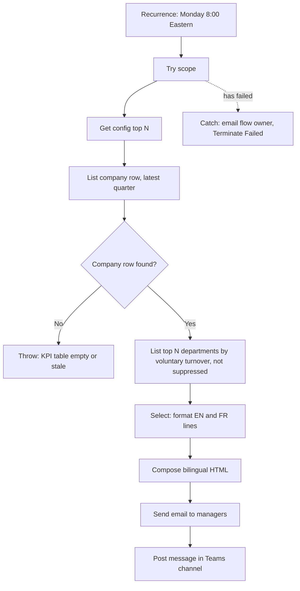

# Flow 2: Monday KPI digest

**Name:** `HRSS - 2 Monday KPI digest`
**Description (paste in the flow description):** Every Monday at 8:00 (Eastern), reads the latest quarter KPIs from the HR KPI Excel table and sends a short bilingual digest by email and Teams. Values hidden by the minimum group size of 5 are never shown. Synthetic demo for Laurentian Financial Group.
**Type:** Scheduled cloud flow, in solution `HRSelfService`.
**Data source:** table `KPI_Table` in `HR_KPI_Table.xlsx` (see `00_shared_resources.md`).

## Overview



## Inputs and outputs

| | |
|---|---|
| Input | `KPI_Table` rows where `period_type = Quarter` and `is_latest = Yes`, and the `Config` table. |
| Output | One email to the digest recipients and one Teams channel post, both bilingual. |
| Success | Run Succeeded. Email and Teams post received. Numbers equal the reference (see test plan). |
| Failure | Owner emailed with the run link. Run shows Failed. |

## Trigger

| # | Action | Settings | Comment |
|---|---|---|---|
| 0 | **Recurrence** | Interval 1, Frequency **Week**, On these days **Monday**, At these hours **8**, At these minutes **0**, Time zone **(UTC-05:00) Eastern Time (US and Canada)**. | "Every Monday at 8:00 Montreal time. The time zone setting handles daylight saving." |

## Actions in order

Create two scopes `Try` and `Catch`. Put steps 1 to 8 inside `Try`.

| # | Action (rename to) | Connector and action | Parameters | Comment |
|---|---|---|---|---|
| 1 | `Get config top N` | Excel Online (Business): **List rows present in a table** | File: `hrss_KpiFilePath` (or browse to `HR_KPI_Table.xlsx`). Table: `Config`. Filter Query: `key eq 'digest_top_n'`. Top Count: 1. | "Number of departments to show. Kept in the file so the HR team can change it without editing the flow." |
| 2 | `Set top N` | Variables: **Set variable** (inside Try). The variable `topN` (Integer, value 3) is first created with **Initialize variable** at the top level, above `Try`, because variables cannot be initialized inside a scope. | `topN` = `int(coalesce(first(outputs('Get_config_top_N')?['body/value'])?['value'], 3))` | "Fallback 3 if the config row is missing." |
| 3 | `List company row` | Excel Online (Business): **List rows present in a table** | Table `KPI_Table`. Filter Query: `period_type eq 'Quarter' and is_latest eq 'Yes' and dimension eq 'All'`. Top Count: 1. | "One row with the company totals for the latest quarter." |
| 4 | `Check company row found` | Control: **Condition** | `length(outputs('List_company_row')?['body/value'])` is greater than 0 | "If the table is empty or not filtered correctly we stop with a clear error." |
| 4-No | `Throw error` | Control: **Terminate** | Status Failed, code `KpiTableEmpty`, message "No latest quarter company row in KPI_Table". | "Goes to Catch through the failed status." |
| 5 | `List top departments` | Excel Online (Business): **List rows present in a table** | Table `KPI_Table`. Filter Query: `period_type eq 'Quarter' and is_latest eq 'Yes' and dimension eq 'Department' and suppressed eq 'No'`. Order By: `voluntary_turnover_rate desc`. Top Count: `variables('topN')`. | "Highest voluntary turnover first. Suppressed groups are filtered out, so they can never appear." |
| 6a | `Format lines EN` | Data operation: **Select** | From: `outputs('List_top_departments')?['body/value']`. Map (text mode): `concat(item()?['member'], ': ', formatNumber(mul(float(item()?['voluntary_turnover_rate']), 100), '0.0'), '% (', item()?['headcount'], ' employees)')` | "English bullet per department." |
| 6b | `Format lines FR` | Data operation: **Select** | Same From. Map: `concat(item()?['member'], ' : ', formatNumber(mul(float(item()?['voluntary_turnover_rate']), 100), '0.0', 'fr-CA'), ' % (', item()?['headcount'], ' employés)')` | "French bullet with a decimal comma. Department names stay in English in this demo, see limits." |
| 7 | `Compose digest` | Data operation: **Compose** | HTML below. | "Bilingual body. French first because most recipients are in Quebec." |
| 8a | `Send digest email` | Office 365 Outlook: **Send an email (V2)** | To: `hrss_DigestRecipients`. Subject: `Sommaire RH du lundi / Monday HR digest: @{first(outputs('List_company_row')?['body/value'])?['period']}`. Body: `outputs('Compose_digest')`. Is HTML: Yes. | "The digest for managers. Synthetic data." |
| 8b | `Post digest in Teams` | Microsoft Teams: **Post message in a chat or channel** | Post as: Flow bot. Post in: Channel. Team and Channel: choose the demo team and a channel (create "HR digest"). Message: `outputs('Compose_digest')`. | "Same digest where managers already work." |

Expression helpers used in the HTML (company row):

```
first(outputs('List_company_row')?['body/value'])?['headcount']
mul(float(first(outputs('List_company_row')?['body/value'])?['voluntary_turnover_rate']), 100)
```

Compose digest (HTML, paste as Compose input and replace the placeholders with dynamic content):

```html
<h3>Sommaire RH : @{first(outputs('List_company_row')?['body/value'])?['period']}</h3>
<ul>
  <li>Effectif : <b>@{first(outputs('List_company_row')?['body/value'])?['headcount']}</b></li>
  <li>Roulement volontaire (annualisé) : <b>@{formatNumber(mul(float(first(outputs('List_company_row')?['body/value'])?['voluntary_turnover_rate']),100),'0.0','fr-CA')} %</b></li>
  <li>Taux d'absentéisme : <b>@{formatNumber(mul(float(first(outputs('List_company_row')?['body/value'])?['absence_rate']),100),'0.0','fr-CA')} %</b></li>
  <li>Délai moyen de dotation : <b>@{formatNumber(float(first(outputs('List_company_row')?['body/value'])?['avg_time_to_fill_days']),'0.0','fr-CA')} jours</b></li>
</ul>
<p>Départements avec le roulement volontaire le plus élevé :</p>
<ul><li>@{join(body('Format_lines_FR'),'</li><li>')}</li></ul>
<hr>
<h3>HR digest: @{first(outputs('List_company_row')?['body/value'])?['period']}</h3>
<ul>
  <li>Headcount: <b>@{first(outputs('List_company_row')?['body/value'])?['headcount']}</b></li>
  <li>Voluntary turnover (annualized): <b>@{formatNumber(mul(float(first(outputs('List_company_row')?['body/value'])?['voluntary_turnover_rate']),100),'0.0')}%</b></li>
  <li>Absence rate: <b>@{formatNumber(mul(float(first(outputs('List_company_row')?['body/value'])?['absence_rate']),100),'0.0')}%</b></li>
  <li>Average time to fill: <b>@{formatNumber(float(first(outputs('List_company_row')?['body/value'])?['avg_time_to_fill_days']),'0.0')} days</b></li>
</ul>
<p>Departments with the highest voluntary turnover:</p>
<ul><li>@{join(body('Format_lines_EN'),'</li><li>')}</li></ul>
<p><i>Groups with fewer than 5 employees are hidden. Synthetic data for a fictional company. Definitions: see the metric definitions document.</i></p>
```

### Scope `Catch`

Configure run after: **has failed** and **has timed out** only.

| # | Action | Parameters | Comment |
|---|---|---|---|
| E1 | `Email flow owner` (Send an email V2) | To: `hrss_FlowOwnerEmail`. Subject: `Flow failed: HRSS - 2 Monday KPI digest`. Body: run link and `string(result('Try'))`. | "Owner notification." |
| E2 | `Terminate as failed` (Terminate) | Status Failed, code `DigestFailed`. | "Keeps the run status honest." |

## Expected output for the test (data as generated with seed 20261030)

Company row, latest quarter 2026-Q3: headcount 1488, voluntary turnover 15.8%, absence rate 1.9%, average time to fill 48.3 days. Top 3 departments by voluntary turnover (with `topN` = 3): Marketing 47.1%, Operations 37.5%, Risk and Compliance 16.2%. Compare with `data/reference_kpis.csv` (or `docs/reference_headlines.md`). Legal | Quebec City never appears.

## Test plan (record in `docs/04_results.md` section 5)

1. Save the flow, click **Test > Manually > Test**. Expect Succeeded. Open the run and check the outputs of steps 3, 5 and 7.
2. Compare the email numbers with the expected output above. Screenshot the run as `flow2_run.png` and the email as `flow2_email.png`.
3. Change `digest_top_n` in `Config` to 5 and run again. Expect 5 lines.
4. Failure test: rename the table `KPI_Table` to `KPI_Table_x`, run, expect Catch to email you and the run to be Failed. Rename it back.

## Notes and limits

- Department names are English in the French lines (the KPI table carries English names). A French name column could be added to `KPI_Table`.
- Power BI alternative: the **Run a query against a dataset** action (Power BI connector) can read the same measures with a DAX query. It needs the published report and a licensed account, so this demo uses the Excel table. Because the Excel table comes from the same reference calculation, the numbers equal the report's.
