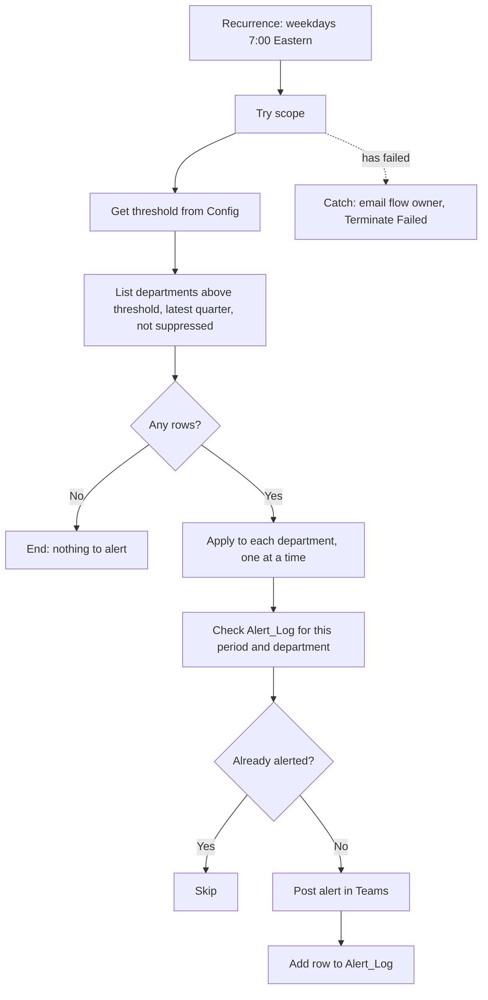

# Flow 3: KPI threshold alert

**Name:** `HRSS - 3 KPI threshold alert`
**Description (paste in the flow description):** Every weekday at 7:00 (Eastern), checks annualized voluntary turnover by department for the latest quarter. If a department is above the threshold stored in the Config table and an alert was not already sent for that period, posts an alert in Teams and logs it. Groups under 5 employees are never evaluated. Synthetic demo for Laurentian Financial Group.
**Type:** Scheduled cloud flow, in solution `HRSelfService`.
**Data source:** tables `KPI_Table`, `Config` and `Alert_Log` in `HR_KPI_Table.xlsx`.

## Overview



## Inputs and outputs

| | |
|---|---|
| Input | `Config` row `voluntary_turnover_threshold` (a fraction, default 0.20). `KPI_Table` rows for the latest quarter at department level. |
| Output | One Teams post per department above the threshold, once per period. One `Alert_Log` row per alert. |
| Success | Run Succeeded. With threshold 0.20 and data for 2026-Q3 the alerts are Marketing (47.1%) and Operations (37.5%). |
| Failure | Owner emailed, run Failed. |

## Trigger

| # | Action | Settings | Comment |
|---|---|---|---|
| 0 | **Recurrence** | Interval 1, Frequency **Week**, On these days **Monday, Tuesday, Wednesday, Thursday, Friday**, At these hours **7**, At these minutes **0**, Time zone **(UTC-05:00) Eastern Time (US and Canada)**. | "Daily check on weekdays. The KPI table changes rarely, the log prevents duplicate alerts." |

## Actions in order

Initialize variable `threshold` (Float) above the scopes (variables cannot be initialized inside a scope). Then create scopes `Try` and `Catch`.

| # | Action (rename to) | Connector and action | Parameters | Comment |
|---|---|---|---|---|
| 1 | `Get threshold row` | Excel Online (Business): **List rows present in a table** | Table `Config`. Filter Query: `key eq 'voluntary_turnover_threshold'`. Top Count 1. | "Threshold lives in the file, not in the flow." |
| 2 | `Set threshold` | Variables: **Set variable** (inside Try) | `threshold` = `float(coalesce(first(outputs('Get_threshold_row')?['body/value'])?['value'], 0.2))` | "Falls back to 20% if the config row is missing." |
| 3 | `List departments above threshold` | Excel Online (Business): **List rows present in a table** | Table `KPI_Table`. Filter Query: `period_type eq 'Quarter' and is_latest eq 'Yes' and dimension eq 'Department' and suppressed eq 'No' and voluntary_turnover_rate gt @{variables('threshold')}`. | "Server side filter. Suppressed groups cannot be returned." |
| 4 | `Any departments above threshold` | Control: **Condition** | `length(outputs('List_departments_above_threshold')?['body/value'])` is greater than 0 | "Nothing to do when everything is below the threshold." |
| 5 | `For each department` | Control: **Apply to each** (in the Yes branch) | Input: `outputs('List_departments_above_threshold')?['body/value']`. Settings > Concurrency control: On, degree 1. | "One at a time so two alerts cannot both miss the log." |
| 5.1 | `Check alert log` | Excel Online (Business): List rows present in a table | Table `Alert_Log`. Filter Query: `period eq '@{items('For_each_department')?['period']}' and member eq '@{items('For_each_department')?['member']}' and kpi eq 'voluntary_turnover_rate'`. | "Has this department already been alerted for this period?" |
| 5.2 | `Not yet alerted` | Control: **Condition** | `length(outputs('Check_alert_log')?['body/value'])` is equal to 0 | "Deduplication." |
| 5.2-Yes-a | `Post alert in Teams` | Microsoft Teams: **Post message in a chat or channel** | Post as Flow bot, in Channel (create "HR alerts"). Message (below). | "The alert itself." |
| 5.2-Yes-b | `Log alert` | Excel Online (Business): **Add a row into a table** | Table `Alert_Log`. `logged_on`: `utcNow()`. `period`, `member`, `kpi` (`voluntary_turnover_rate`), `value`, `threshold`: `variables('threshold')`. | "Remembers that this alert was sent." |

Teams message (HTML):

```html
<b>HR alert / Alerte RH</b><br>
<b>@{items('For_each_department')?['member']}</b> : roulement volontaire annualisé <b>@{formatNumber(mul(float(items('For_each_department')?['voluntary_turnover_rate']),100),'0.0','fr-CA')} %</b> (@{items('For_each_department')?['period']}), seuil @{formatNumber(mul(variables('threshold'),100),'0.0','fr-CA')} %.<br>
<b>@{items('For_each_department')?['member']}</b>: annualized voluntary turnover <b>@{formatNumber(mul(float(items('For_each_department')?['voluntary_turnover_rate']),100),'0.0')}%</b> (@{items('For_each_department')?['period']}), threshold @{formatNumber(mul(variables('threshold'),100),'0.0')}%.<br>
Group size / Taille du groupe : @{items('For_each_department')?['group_size']}. Synthetic data / Données synthétiques.
```

Note on `eq`/`gt` with numbers in the filter query: if Power Automate returns an "unsupported" error on the `gt` with a float, wrap the value in `string(...)` or use a Filter array action instead of the server side filter (filter the full list of latest-quarter department rows with `greater(float(item()?['voluntary_turnover_rate']), variables('threshold'))`). Blank cells (suppressed rows) fail `float()`, which is why `suppressed eq 'No'` is in the server side filter first. Log what happened in `docs/04_results.md`.

### Scope `Catch`

Configure run after: **has failed** and **has timed out** only.

| # | Action | Parameters | Comment |
|---|---|---|---|
| E1 | `Email flow owner` (Send an email V2) | To: `hrss_FlowOwnerEmail`. Subject: `Flow failed: HRSS - 3 KPI threshold alert`. Body: run link and `string(result('Try'))`. | "Owner notification." |
| E2 | `Terminate as failed` (Terminate) | Status Failed, code `AlertFailed`. | "Honest run status." |

## Test plan (record in `docs/04_results.md` section 5)

1. **Two alerts.** Threshold 0.20. Test manually. Expect Teams posts for Marketing (47.1%) and Operations (37.5%), two rows in `Alert_Log`, run Succeeded. Screenshots: `flow3_run.png`, `flow3_teams_alert.png`.
2. **No duplicate.** Run again immediately. Expect no new posts and no new log rows (the run still Succeeded, the "Not yet alerted" condition is false).
3. **No alert.** Set threshold to 0.60 and clear `Alert_Log` rows. Run. Expect the "Any departments" condition to be No and no posts.
4. **Group size rule.** Confirm that `Legal | Quebec City` and any other row with `suppressed = Yes` never appear. (They are Department x Location rows, so the department filter already excludes them. The rule matters when the threshold is applied to the Location or Job level dimension later.)
5. **Error path.** Rename the `Config` table temporarily. Expect Catch email and Failed run.
6. Reset the threshold to 0.20 and clear the log after testing.

## Optional extra: Power BI data alert

A data alert on a published card (for example Operations voluntary turnover) can trigger a flow with "When a data driven alert is triggered". It needs a published report, a card pinned to a dashboard, and a licence. It is not part of the required build. If you add it, say so in the README only after it ran.
