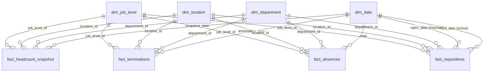

# Power BI model

Fictional company: Laurentian Financial Group. All data is synthetic. You build the `.pbix` in Power BI Desktop from this description. Measures are in `measures.dax`, pages in `report_spec.md`.

## Star schema

Standalone tables with **no relationships**: `Language` (EN and FR toggle, created with DATATABLE, see `measures.dax`), `dq_employee` (only for the Data quality page counts), `_Measures` (holds measures).

## Source files and table names

Load from the `data/` folder with Get Data > Text/CSV. Set **File Origin to 65001: Unicode (UTF-8)** so the French accents display correctly. Rename on load.

| Power BI table | Source CSV | Grain | Expected rows (seed 20261030) |
|---|---|---|---|
| `dim_date` | `dates.csv` | one row per calendar day, 2023-01-01 to 2026-12-31 | 1,461 |
| `dim_department` | `departments.csv` | one row per department | 10 |
| `dim_location` | `locations.csv` | one row per location | 4 |
| `dim_job_level` | `job_levels.csv` | one row per level | 6 |
| `fact_headcount_snapshot` | `fact_headcount_snapshot.csv` | employee x month (employed at any time in the month) | 50,000 |
| `fact_terminations` | `fact_terminations.csv` | one row per exit | 671 |
| `fact_absences` | `fact_absences.csv` | employee x day absent | 76,911 |
| `fact_requisitions` | `requisitions.csv` | one row per requisition | 733 |
| `dq_employee` | `employees.csv` | one row per employee (data quality counts only) | 2,159 |

After loading, compare the row counts in the Data view (or Power Query "Column profile" with "Count") with the table. If they differ, the files were regenerated with another seed, or an import setting is wrong.

## Relationships

All are **many to one**, **single direction** (dimension filters fact), cross-filter direction Single.

| From (many side) | To (one side) | Active |
|---|---|---|
| `fact_headcount_snapshot[snapshot_date]` | `dim_date[date]` | Yes |
| `fact_terminations[termination_date]` | `dim_date[date]` | Yes |
| `fact_absences[date]` | `dim_date[date]` | Yes |
| `fact_requisitions[filled_date]` | `dim_date[date]` | **Yes** (time to fill is reported in the period it was filled) |
| `fact_requisitions[open_date]` | `dim_date[date]` | No (use `USERELATIONSHIP` if you add an "opened in period" measure) |
| each fact `[department_id]` | `dim_department[department_id]` | Yes |
| each fact `[location_id]` | `dim_location[location_id]` | Yes |
| each fact `[job_level_id]` | `dim_job_level[job_level_id]` | Yes |

Do not create relationships between facts. Do not enable bidirectional filtering.

## Column settings

Set data types in Power Query: dates as Date, `hours` and `scheduled_hours` as Decimal Number, flags (`active_at_month_end`, `hired_in_month`, `counts_in_absence_rate`, `is_weekday`, `is_month_end`, `is_in_data_range`) as Whole Number, everything else as Text or Whole Number as in `data/data_dictionary.csv`.

**Mark `dim_date` as the date table** (Table tools > Mark as date table, column `date`).

Sort-by columns: `dim_date[month_name_en]` and `[month_name_fr]` sort by `month_number`; `dim_job_level[level_name_en]` and `[level_name_fr]` sort by `level_order`.

Hierarchy on `dim_date`: Year > Quarter (`quarter_label`) > Month (`year_month`).

**Hide from report view (privacy and clarity):**
- `employee_id` in every fact table and in `dq_employee` (all columns of `dq_employee` hidden).
- All foreign key columns (`department_id`, `location_id`, `job_level_id`) in the fact tables.
- Every measure ending in `(raw)` and the helper measures (`Group Size`, `Group Is Visible`, `Time To Fill Is Visible`, `Months In Period`).

Summarization: set every numeric column to "Don't summarize" so nobody drags a raw column into a visual. Use measures only.

## Naming and display folders

Put all measures in the `_Measures` table, with display folders `0 Config` to `9 Data quality` as marked in `measures.dax`. Format: headcount and counts `#,0`; rates `0.0%`; time to fill `0.0`.

## Privacy rule (how it works)

1. `[Group Size]` is MIN(average month-end headcount in the filter context, headcount at the last month end in the filter context).
2. If `[Group Size]` is below `[Min Group Size]` (5), the report-numeric measures return BLANK and the text measures return "Not enough data" (or "Données insuffisantes" when the language toggle is FR).
3. Time to fill uses the number of filled requisitions instead (below 5 is hidden).
4. The company total is never below 5, so no special case is needed in DAX. Dimension members are evaluated one by one, so a bar for a small department is blank while the others show.

Why MIN and not only the average: a group that shrank to 4 at the end of the period should not show a headcount of 4, even if the average over the quarter is 5.2.

## Row-level security

None. The model contains no visual that exposes rows, and viewers get the report only. If department-scoped views are required later, add a role filtering `dim_department[department_id]`, and test every page again, because suppression is evaluated inside the filtered scope.

## Known modelling limits

- Department, location and job level are static per employee, so history of transfers is not modelled (and neither is internal mobility).
- The snapshot is at month end only. Use Year, Quarter and Month fields for slicers, not a day range.
- Statutory holidays are not removed from scheduled hours.
- Time to fill for the latest periods is biased low, because slow requisitions are still open.
- `dq_employee` puts employee-level rows in the model, only to compute the data quality counts. In a real deployment, compute these checks upstream and load only the results.
